# راهنمای استفاده از PersonalCost — هزینه‌های شخصی

این راهنما برای استفاده **بعد از نصب** است: از ثبت اولین درآمد و هزینه تا خواندن آمار، آموزش پیامک بانکی و انتقال اطلاعات به گوشی دیگر. برای نصب و اجرای پروژه، [README](README.md) را ببینید.

> تصاویر، اسکرین‌شات واقعی رابط **نسخهٔ وب** با اندازهٔ نمای موبایل هستند؛ همهٔ مبلغ‌ها، یادداشت‌ها، پیامک‌ها، نام بانک‌ها و سرشماره‌ها **ساختگی**‌اند. تراکنش‌های پیامکیِ تصاویر، دادهٔ نمایشی هستند، نه نتیجهٔ دریافت پیامک در مرورگر. رابط بخش‌های مشترک در اندروید نیز همین است؛ دسترسی پیامک و ویجت فقط در اندروید وجود دارند و تصویر اندرویدی آن‌ها در این راهنما نیست. فرم‌های «تراکنش جدید» و «آموزش پیامک» قبل از ذخیره عکس گرفته شده‌اند، بنابراین مبلغ آن‌ها هنوز به جمع‌های نمونه اضافه نشده است.

## فهرست

- [۱. معرفی محصول و تفاوت نسخه‌ها](#product)
- [۲. مفاهیم اصلی: تومان، تگ و پول](#concepts)
- [۳. شروع سریع پس از نصب](#quick-start)
- [۴. خانه: نمای روزانه و بررسی تراکنش‌ها](#home)
- [۵. افزودن هزینه یا درآمد دستی](#manual)
- [۶. تاریخچه، اصلاح و حذف تراکنش](#history)
- [۷. آمار کلی، جست‌وجو و تقویم خرج](#stats)
- [۸. آمار پول‌ها و جزئیات هر پول](#funds)
- [۹. تنظیمات، بانک‌ها و تگ‌ها](#settings)
- [۱۰. پیامک بانکی و آموزش الگو](#sms)
- [۱۱. یادآور روزانه و ویجت اندروید](#android)
- [۱۲. پشتیبان‌گیری و انتقال داده](#backup)
- [۱۳. تمرین با دادهٔ نمونه](#sample)
- [۱۴. مشکلات رایج و پاسخ پرسش‌ها](#faq)

## ۱. معرفی محصول و تفاوت نسخه‌ها

PersonalCost دفتر شخصی دخل‌وخرج شماست. می‌توانید درآمد و هزینه را ثبت کنید، مشخص کنید هر خرج بابت چه بوده و از کدام منبع درآمد پرداخت شده، و با آمار ماهانه یا بازهٔ دلخواه وضعیت مالی خود را ببینید.

- **بدون حساب کاربری و سرور:** اطلاعات مالی روی همان دستگاه یا مرورگر نگهداری می‌شوند؛ به سرور برنامه ارسال نمی‌شوند.
- **ثبت دستی:** برای خرج نقدی، درآمد بدون پیامک یا هر تراکنش ثبت‌نشده.
- **ثبت پیامکی در اندروید:** پیامک بانک‌هایی که معرفی کرده‌اید، با اجازهٔ شما به تراکنش تبدیل می‌شود.
- **دسته‌بندی هزینه و مدیریت منابع درآمد:** مثلاً «خوراک از حقوق» یا «تجهیزات از پروژه».
- **گزارش شمسی:** تاریخچه، نمودار هزینه، تقویم خرج و گزارش هر پول.

| امکان | اپ اندروید (APK) | وب / PWA |
| --- | --- | --- |
| ثبت دستی، تگ‌ها، تاریخچه و آمار | دارد | دارد |
| دریافت خودکار پیامک بانک | با ثبت سرشماره و دادن دسترسی | ندارد |
| آموزش الگو از متن نمونه یا تراکنش پیامکی | دارد | رابط آموزش دارد؛ پیامک تازه دریافت نمی‌کند |
| اعلان یادآور و ویجت صفحهٔ اصلی گوشی | دارد | ندارد |
| خروجی و بازیابی JSON | دارد | دارد |
| اشتراک خودکار داده با دستگاه دیگر | ندارد | ندارد |

نسخهٔ وب را می‌توانید از [GitHub Pages پروژه](https://arahmatiiii.github.io/PersonalCosts/) باز کنید و، اگر مرورگرتان پشتیبانی کند، از منوی مرورگر «نصب برنامه / Install app» یا «افزودن به صفحهٔ اصلی / Add to Home screen» را بزنید. پس از بارگذاری و ذخیرهٔ اولیهٔ فایل‌های برنامه، PWA برای بازشدن آفلاین طراحی شده است. برای APK به [انتشارهای پروژه](https://github.com/arahmatiiii/PersonalCosts/releases/tag/apk) مراجعه کنید.

> این برنامه به حساب بانکی متصل نیست و انتقال وجه انجام نمی‌دهد. عدد «ماندهٔ پول‌ها» یا «خالص» گزارش تراکنش‌های ثبت‌شده است، نه موجودی واقعی حساب بانکی شما.

## ۲. مفاهیم اصلی: تومان، تگ و پول

| اصطلاح | معنی | مثال |
| --- | --- | --- |
| هزینه | پولی که خرج کرده‌اید | خرید ۱۸۰٬۰۰۰ تومانی |
| درآمد | پولی که دریافت کرده‌اید | حقوق ۳۰٬۰۰۰٬۰۰۰ تومانی |
| بانک / نقدی | محل ثبت تراکنش؛ از منبع درآمد جداست | بانک نمونه یا نقدی |
| تگ هزینه | پاسخ «این خرج بابت چه بود؟» | اسنپ، خوراک، اجاره |
| پول (تگ درآمد) | نام منبع درآمدی که می‌توان خرج را به آن وصل کرد | حقوق، پروژه |
| «از» | انتخاب پولی که هزینه از آن پرداخت شده | خوراک، از حقوق |
| بدون تگ | هنوز مشخص نکرده‌اید تراکنش چه بوده | خریدی که نیاز به بررسی دارد |
| بدون پول | هزینه‌ای که هیچ منبع درآمدی برای آن انتخاب نکرده‌اید | خرید نقدی با تگ خوراک، بدون انتخاب «از» |

**همهٔ مبلغ‌های نمایش‌داده‌شده و ورودی دستی به تومان‌اند.** پیامک ممکن است ریالی باشد؛ برنامه مبلغ را به تومان نمایش می‌دهد. مثلاً پیامک **۱٬۸۰۰٬۰۰۰ ریال** باید **۱۸۰٬۰۰۰ تومان** دیده شود. در آموزش پیامک، واحد عدد داخل متن را انتخاب کنید، نه واحد دلخواه نمایش.

یک **تگ پول به‌تنهایی پول ایجاد نمی‌کند**: باید یک درآمد را با آن تگ ثبت کنید. درآمدهای هم‌نام در یک ماه شمسی با هم یک پول می‌سازند؛ مثلاً دو درآمد با تگ «پروژه» در مهر، به ورودی «پروژهٔ مهر» اضافه می‌شوند. «حقوق مهر» و «حقوق شهریور» پول‌های ماهانهٔ جدا هستند.

**بدون تگ با بدون پول فرق دارد:** یک هزینه می‌تواند تگ «خوراک» داشته باشد ولی از هیچ پولی کم نشود. برای کم‌شدن آن از حقوق، علاوه بر تگ، در قسمت **«از» → «حقوق»** را هم انتخاب کنید.

## ۳. شروع سریع پس از نصب

۱. از نوار پایین وارد **تنظیمات** شوید. در شروع، تگ‌های هزینهٔ «اسنپ» و «شارژ» و تگ پول «حقوق» وجود دارند؛ موارد موردنیازتان را اضافه کنید.
۲. اگر اندروید دارید و ثبت پیامکی می‌خواهید، در **بانک‌ها** نام بانک و **سرشمارهٔ واقعی فرستندهٔ پیامک آن** را وارد کنید و دکمهٔ **+** همان ردیف را بزنید. سپس در **دسترسی‌ها → دریافت خودکار پیامک → فعال‌سازی** مجوزها را بدهید. [جزئیات](#sms)
۳. به **خانه** برگردید، دکمهٔ شناور **+** را بزنید، **درآمد** را انتخاب کنید و مثلاً ۳۰٬۰۰۰٬۰۰۰ تومان با تگ **حقوق** ثبت کنید.
۴. دوباره **+** را بزنید و یک **هزینه**، مثلاً ۱۸۰٬۰۰۰ تومان، با تگ **اسنپ** و گزینهٔ **از → حقوق** ثبت کنید.
۵. در خانه ماندهٔ حقوق و خرج ماه را ببینید؛ برای جزئیات به **آمار** بروید.
۶. در **تنظیمات → پشتیبان‌گیری → خروجی** یک نسخهٔ پشتیبان بگیرید.

در وب یا در صورت ندادن مجوز پیامک، قدم دوم اختیاری است؛ می‌توانید همهٔ تراکنش‌ها را دستی ثبت کنید. بهتر است بانک‌ها را پیش از دریافت پیامک‌های جدید تعریف کنید؛ افزودن بانک، پیامک‌های قدیمی صندوق پیام گوشی را وارد برنامه نمی‌کند.

## ۴. خانه: نمای روزانه و بررسی تراکنش‌ها

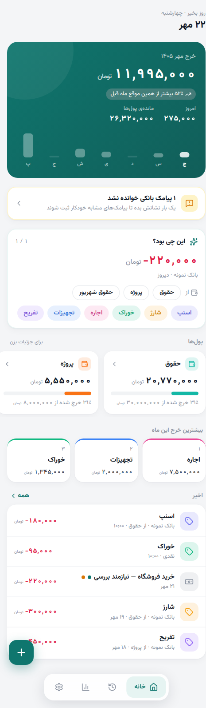

از نوار پایین روی نماد خانه بزنید. این صفحه برای مرور سریع وضعیت و رسیدگی به تراکنش‌های تازه است:

- **خرج ماه:** مجموع هزینه‌های ثبت‌شدهٔ ماه جاری شمسی، به تومان.
- **امروز:** هزینه‌های امروز.
- **ماندهٔ پول‌ها:** جمع ماندهٔ پول‌های ماه جاری؛ اگر درآمد تگ‌خورده‌ای نداشته باشید نمایش داده نمی‌شود.
- **مقایسه با ماه قبل:** اگر دادهٔ قابل‌مقایسه موجود باشد، درصد افزایش یا کاهش خرج نسبت به همین موقع ماه قبل نمایش داده می‌شود.
- **میله‌های هفتگی:** مقایسهٔ خرج روزهای اخیر.
- **پیامک بانکی خوانده نشد:** فقط وقتی پیامک نامفهوم وجود داشته باشد؛ لمس آن لیست پیامک‌ها را باز می‌کند. [آموزش خواندن پیامک](#sms)
- **پول‌ها:** کارت هر منبع درآمد با مانده و درصد مصرف؛ برای دیدن جزئیات روی کارت بزنید.
- **بیشترین خرج این ماه:** حداکثر سه تگ پرهزینهٔ ماه.
- **اخیر:** پنج تراکنش تازه؛ برای مشاهده و اصلاح روی ردیف بزنید. دکمهٔ **همه**، در صورت وجود موارد بیشتر، تاریخچه را باز می‌کند.
- **+ شناور:** بازکردن فرم تراکنش جدید.

### کارت «این چی بود؟»

این کارت تراکنش‌های **بدون تگ** را، ابتدا از قدیمی‌ترها، یکی‌یکی نشان می‌دهد:

۱. مبلغ، بانک و زمان را بررسی کنید.
۲. برای هزینه، اگر می‌خواهید از یک پول کم شود، **اول** در قسمت **از** پول را انتخاب کنید.
۳. سپس تگ مناسب را بزنید؛ **با لمس تگ، انتخاب فوراً ذخیره می‌شود** و مورد بعدی می‌آید. دکمهٔ ذخیرهٔ جداگانه ندارد.
۴. فلش **بعدی** فقط مورد دیگری را نشان می‌دهد؛ تراکنش فعلی را حذف یا تگ‌گذاری نمی‌کند.
۵. اگر اشتباه تگ زدید، در پیام پایین صفحه **برگرداندن** را بزنید؛ این فرصت حدود پنج ثانیه است. بعد از آن هم از تاریخچه می‌توانید اصلاح کنید.

برای درآمد، این کارت تگ‌های **پول** را نشان می‌دهد. برای هزینه، تگ‌های **هزینه** را نشان می‌دهد. اگر نوع تراکنش نامطمئن یا اشتباه است، **پیش از تگ‌زدن** آن را از تاریخچه یا لیست اخیر باز و هزینه/درآمد بودنش را اصلاح کنید؛ کارت سریع، تغییر نوع ندارد.

در صفحه‌های دیگر، نشان تعداد روی نماد خانه تعداد تراکنش‌های منتظر تگ را یادآوری می‌کند.

## ۵. افزودن هزینه یا درآمد دستی

در **خانه → +** فرم **تراکنش جدید** باز می‌شود. بستن فرم بدون زدن **افزودن** چیزی ثبت نمی‌کند.

### ثبت درآمد و ساخت پول

۱. مبلغ مثبت را **به تومان** وارد کنید؛ مثلاً ۵٬۰۰۰٬۰۰۰.
۲. **درآمد** را انتخاب کنید.
۳. **نقدی** یا، اگر بانک تعریف کرده‌اید، نام بانک را انتخاب کنید. انتخاب بانک فقط نام تراکنش را مشخص می‌کند و کاری در حساب واقعی انجام نمی‌دهد.
۴. زیر «این درآمد کدام پول است؟»، مثلاً **پروژه** را بزنید.
۵. یادداشت اختیاری بنویسید و تاریخ را انتخاب کنید.
۶. **افزودن** را بزنید. این درآمد به پول همان ماه اضافه می‌شود.

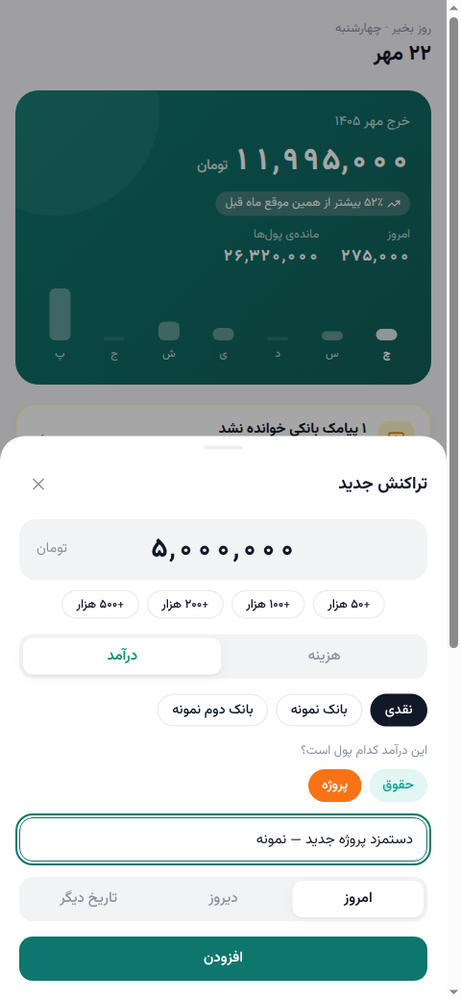

### ثبت هزینه و انتخاب منبع پرداخت

۱. مبلغ را وارد کنید؛ برای خرج ۱۸۰٬۰۰۰ تومانی، **۱۸۰۰۰۰** بنویسید، نه مبلغ ریالی.
۲. **هزینه** را انتخاب کنید؛ لازم نیست عدد منفی وارد کنید.
۳. نقدی یا بانک را انتخاب کنید.
۴. **تگ هزینه**، مثلاً اسنپ، را انتخاب کنید.
۵. در **از**، مثلاً **حقوق** را انتخاب کنید تا هزینه از ماندهٔ آن پول کم شود. اگر پولی ندارید، ابتدا درآمد تگ‌خورده ثبت کنید.
۶. یادداشت و تاریخ را وارد کنید و **افزودن** را بزنید.

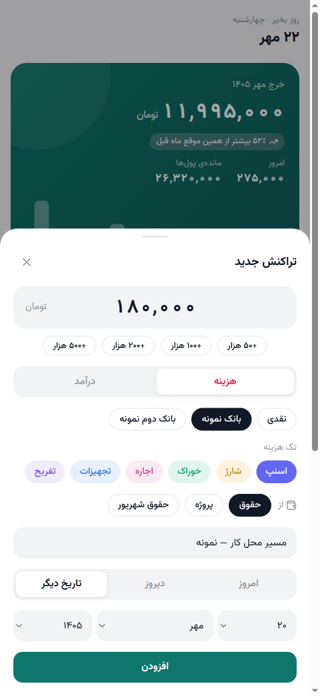

نکته‌های فرم:

- دکمه‌های **+۵۰ هزار، +۱۰۰ هزار، +۲۰۰ هزار و +۵۰۰ هزار** به مبلغ فعلی اضافه می‌کنند؛ مبلغ را جایگزین نمی‌کنند.
- **امروز / دیروز / تاریخ دیگر** برای تعیین تاریخ‌اند. در «تاریخ دیگر» روز، ماه شمسی و سال را انتخاب کنید.
- تاریخ هزینه را قبل از انتخاب نهایی «از» مشخص کنید و منبع را بازبینی کنید؛ گزینه‌های پول به ماه تراکنش وابسته‌اند.
- پول‌های ماه خود تراکنش و تا دو ماه قبل و بعد آن قابل‌انتخاب‌اند؛ برای ماه متفاوت نام ماه هم دیده می‌شود، مثل **حقوق شهریور**.
- لمس دوبارهٔ تگ یا پول انتخاب‌شده، آن را از انتخاب خارج می‌کند.
- انتخاب تگ و پول اختیاری است؛ بدون تگ، تراکنش در کارت بررسی خانه می‌ماند. بدون انتخاب «از»، هزینه در گزارش **بدون پول** می‌آید.
- با عوض‌کردن هزینه/درآمد در فرم جدید، انتخاب تگ و پول پاک می‌شود؛ گزینهٔ مناسب نوع جدید را دوباره انتخاب کنید.

## ۶. تاریخچه، اصلاح و حذف تراکنش

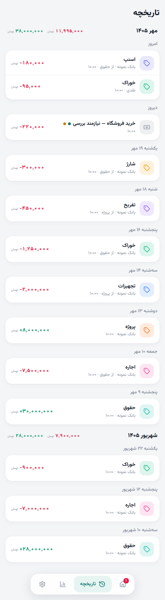

از نوار پایین روی نماد تاریخچه بزنید:

- تراکنش‌ها از جدید به قدیم، بر اساس ماه شمسی و سپس روز گروه‌بندی شده‌اند.
- کنار نام ماه، جمع هزینه و، اگر وجود داشته باشد، درآمد همان ماه نمایش داده می‌شود.
- جمع ماهانه شامل همهٔ تراکنش‌های ماه است، نه فقط ردیف‌هایی که فعلاً روی صفحه دیده می‌شوند.
- ابتدا حداکثر ۶۰ تراکنش بارگذاری می‌شود؛ دکمهٔ **بیشتر** موارد قدیمی‌تر را نشان می‌دهد.
- نقطهٔ سبز/فیروزه‌ای کنار عنوان یعنی **بدون تگ**؛ نقطهٔ کهربایی یعنی **نوع نامطمئن** و نیازمند بررسی.

### اصلاح جزئیات

روی یک تراکنش بزنید تا جزئیات باز شود. همین صفحه از خانه، آمار و جزئیات پول هم قابل‌دسترسی است.

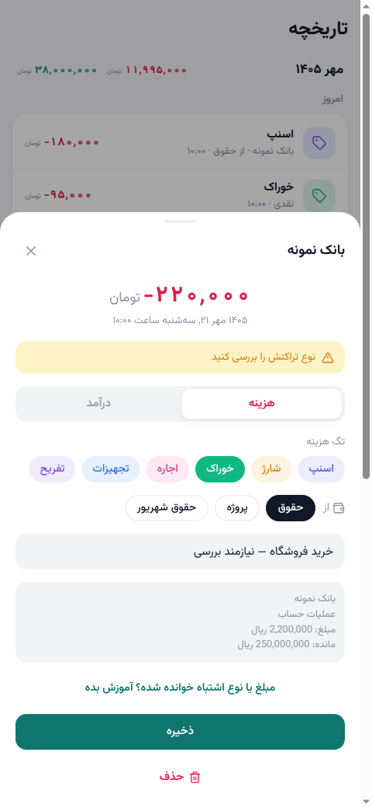

۱. مبلغ و تاریخ بالای صفحه را بررسی کنید.
۲. **هزینه / درآمد** را در صورت نیاز اصلاح کنید.
۳. تگ، پولِ قسمت **از** و یادداشت را تنظیم کنید.
۴. برای اعمال این تغییرها **ذخیره** را بزنید؛ صرف بستن پنجره آن‌ها را ذخیره نمی‌کند.

اگر تراکنش از پیامک آمده باشد، متن اصلی را هم می‌بینید. برای مبلغ یا نوع اشتباه، از **«مبلغ یا نوع اشتباه خوانده شده؟ آموزش بده»** استفاده کنید. [مراحل آموزش](#sms)

> مبلغ و تاریخ در صفحهٔ جزئیات، ورودی ویرایش ندارند. برای اشتباه در مبلغ یا تاریخ یک ثبت دستی، تراکنش درست را دوباره ثبت و مورد اشتباه را حذف کنید. برای اشتباهِ خواندن مبلغ پیامکی، آموزش همان تراکنش می‌تواند مبلغ و نوع آن را اصلاح کند.

### حذف و برگرداندن

دکمهٔ **حذف** فوراً تراکنش را حذف می‌کند و پیام پایین صفحه می‌آید. برای لغو، در همان پیام **برگرداندن** را بزنید؛ فرصت حدود پنج ثانیه است. حذف یک درآمد ممکن است ورودی و ماندهٔ پول مربوط به آن را تغییر دهد. پیش از حذف‌های مهم پشتیبان بگیرید.

پنجره‌ها با **×** بسته می‌شوند؛ در اندروید دکمهٔ برگشت نیز پنجرهٔ بالایی را می‌بندد. در پنجره‌های بلند برای دیدن ادامهٔ اطلاعات به پایین اسکرول کنید.

## ۷. آمار کلی، جست‌وجو و تقویم خرج

از نوار پایین روی نماد نمودار بزنید. ابتدا بازه را مشخص کنید؛ سپس **آمار کلی** یا **آمار پول‌ها** را انتخاب کنید.

### انتخاب ماه یا بازهٔ دلخواه

- در حالت **ماه**، فلش‌ها ماه قبل و بعد را نشان می‌دهند؛ جلوتررفتن از ماه جاری غیرفعال است.
- در **بازهٔ دلخواه**، تاریخ شمسی **از** و **تا** را انتخاب کنید. روز شروع و پایان داخل گزارش حساب می‌شوند. اگر تاریخ‌ها را برعکس انتخاب کنید، برنامه بازه را از کوچک‌تر به بزرگ‌تر مرتب می‌کند.
- بازهٔ انتخاب‌شده در هر دو تب آمار استفاده می‌شود؛ تقویم خرج فقط در حالت **ماه** نمایش داده می‌شود.

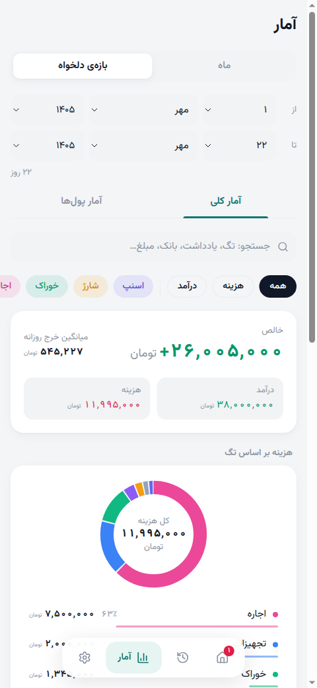

### خواندن آمار کلی

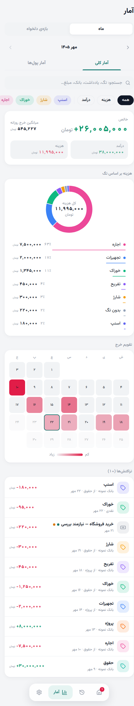

- **درآمد:** جمع درآمدهای محدوده و فیلتر فعلی.
- **هزینه:** جمع هزینه‌های محدوده و فیلتر فعلی.
- **خالص:** درآمد منهای هزینه؛ مثبت یعنی درآمد بیشتر بوده، نه لزوماً موجودی حساب.
- **میانگین خرج روزانه:** هزینه تقسیم بر تعداد روزهای بازه تا امروز؛ فقط تعداد روزهای دارای تراکنش نیست.
- **هزینه بر اساس تگ:** نمودار حلقه‌ای و فهرست سهم هر تگ؛ هزینه‌های تگ‌نخورده زیر **بدون تگ** می‌آیند.
- **تقویم خرج:** رنگ پررنگ‌تر یعنی خرج بیشتر در آن روز. روی روز بزنید تا مبلغ خرج همان روز زیر تقویم دیده شود؛ این کار فهرست تراکنش‌ها را فیلتر نمی‌کند. روزهای آینده غیرفعال‌اند.
- **تراکنش‌ها:** ردیف‌های منطبق با بازه و فیلترها؛ ابتدا ۲۰ مورد و سپس با **بیشتر** موارد بعدی.

### جست‌وجو و فیلتر

۱. در کادر جست‌وجو، تگ، یادداشت، بانک، نام پول، بخشی از متن پیامک یا مبلغ را بنویسید.
۲. با **همه / هزینه / درآمد** نوع را محدود کنید.
۳. تگ‌های موردنظر را بزنید؛ چند تگ قابل‌انتخاب‌اند و ردیف‌های دارای هرکدام نمایش داده می‌شوند.
۴. لمس نام تگ در فهرست زیر نمودار هم فیلتر تگ را تغییر می‌دهد.
۵. برای برگشت به کل بازه، **پاک کردن فیلترها** را بزنید؛ × کنار جست‌وجو فقط متن جست‌وجو را پاک می‌کند.

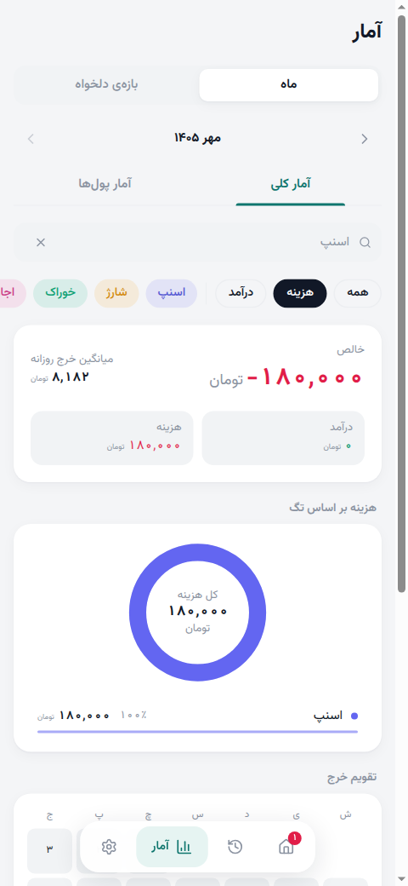

**خلاصه، نمودار و تقویم نیز با فیلترها تغییر می‌کنند.** مثلاً در فیلتر «هزینه»، درآمدِ نمایش‌داده‌شده صفر است؛ این به معنی حذف درآمدهای شما نیست. برای جست‌وجوی مبلغ، عدد تومانی را بدون جداکنندهٔ هزارگان بنویسید، مثلاً **180000** یا **۱۸۰۰۰۰**.

## ۸. آمار پول‌ها و جزئیات هر پول

در **آمار → آمار پول‌ها** ببینید هر منبع درآمد چقدر ورودی و خرج داشته است.

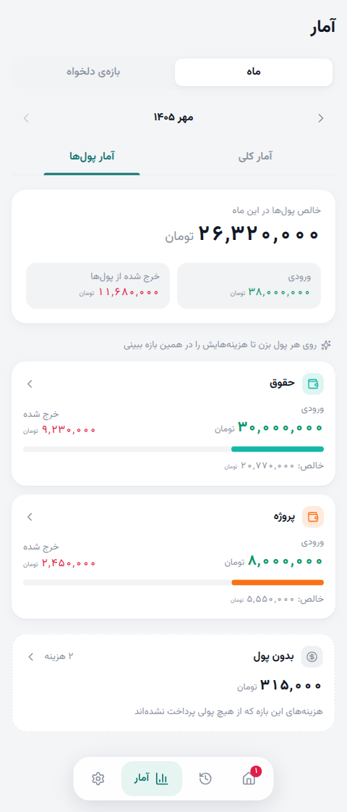

هر کارت، **ورودی، خرج شده و خالص** آن پول را نشان می‌دهد. دکمهٔ **بدون پول**، اگر چنین هزینه‌ای وجود داشته باشد، هزینه‌هایی را نشان می‌دهد که به هیچ پولی وصل نشده‌اند.

### جزئیات پول

روی **حقوق** یا هر پول دیگر بزنید؛ همین پنجره از کارت پول در خانه هم باز می‌شود.

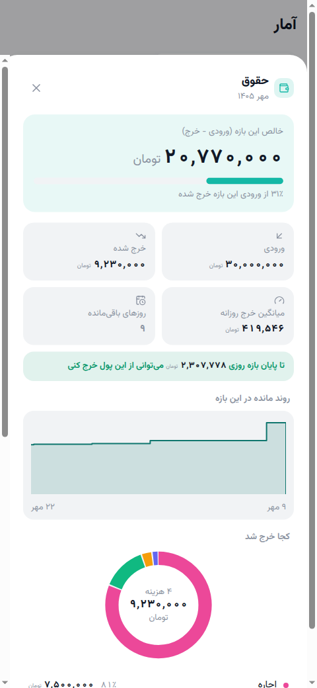

- **خالص:** ورودی منهای خرج مرتبط.
- **درصد مصرف:** سهم خرج از ورودی آن پول.
- **میانگین خرج روزانه** و، برای بازهٔ جاری، **روزهای باقی‌مانده**.
- اگر خالص مثبت و بازه هنوز جاری باشد، مقدار پیشنهادی **خرج روزانه تا پایان بازه** نمایش داده می‌شود. این فقط تقسیم مانده بر روزهای باقی‌مانده است، نه بودجهٔ تضمین‌شده یا محدودیت خرج.
- **روند مانده:** نمودار تغییر ورودی و خروجی؛ در صورت داشتن رویدادهای کافی نمایش داده می‌شود.
- **کجا خرج شد:** تفکیک هزینه‌ها بر اساس تگ. لمس نام تگ، فهرست هزینه‌های پایین همین پنجره را محدود می‌کند، نه جمع اصلی پول را.
- با اسکرول، **ورودی‌ها** و **هزینه‌ها** را می‌بینید؛ لمس هر ردیف جزئیات تراکنش را باز می‌کند.

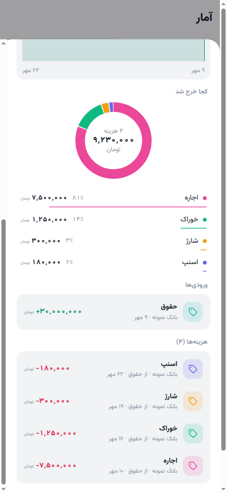

### ماه پول با تاریخ هزینه فرق دارد

در حالت **ماه**، گزارش پول همان پولِ ماه انتخاب‌شده را حساب می‌کند؛ هزینه‌ای که از **حقوق مهر** پرداخت شده، حتی اگر تاریخ خودش در شهریور باشد، از حقوق مهر کم می‌شود. این رفتار با کارت پول در خانه هماهنگ است.

در **بازهٔ دلخواه**، ورودی‌ها و هزینه‌های مرتبط بر اساس **تاریخ خود تراکنش در بازه** گزارش می‌شوند. اگر پول پیش از شروع بازه وارد شده ولی هزینه در بازه باشد، ورودی صفر و خالص منفی ممکن است؛ این لزوماً به معنی منفی‌بودن ماندهٔ کل آن پول نیست.

### رسیدگی به هزینه‌های بدون پول

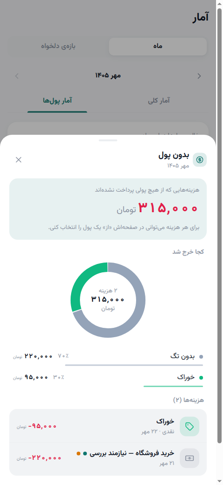

در **بدون پول** روی هزینه بزنید، در قسمت **از** منبع مناسب را انتخاب و **ذخیره** کنید. هزینه از این فهرست خارج و به خرج آن پول اضافه می‌شود. تگ‌زدن به‌تنهایی آن را از «بدون پول» خارج نمی‌کند.

## ۹. تنظیمات، بانک‌ها و تگ‌ها

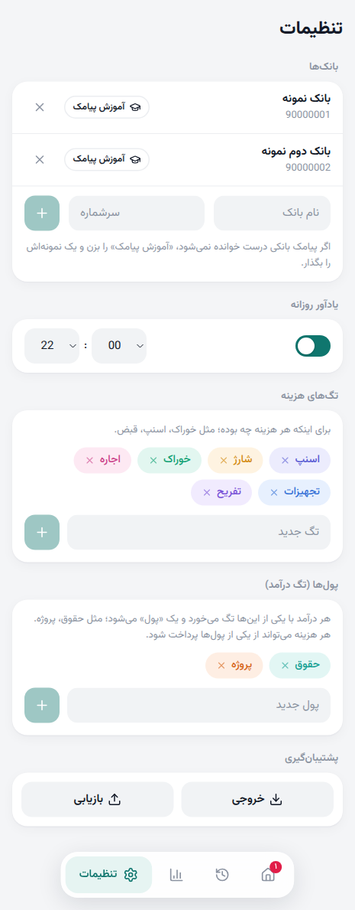

از نوار پایین روی چرخ‌دنده بزنید. تغییرهای تنظیمات در همان لحظه ذخیره می‌شوند؛ دکمهٔ ذخیرهٔ کلی ندارد.

### بانک‌ها

۱. **نام بانک** را وارد کنید؛ این نام برای تشخیص تراکنش‌ها در برنامه است.
۲. **سرشماره** را از فرستندهٔ پیامک واقعی بانک بردارید؛ شمارهٔ حساب، کارت یا شمارهٔ خودتان نیست. اگر فرستنده نام متنی دارد، همان شناسه را وارد کنید.
۳. **+** همان ردیف را بزنید. برای بانک یا فرستندهٔ دیگری این کار را تکرار کنید.
۴. برای متن‌های مشکل‌دار، **آموزش پیامک** کنار بانک را بزنید. اگر الگو ذخیره کرده باشید، تعداد **الگو** روی همان دکمه دیده می‌شود.
۵. برای حذف بانک، **×** کنار آن را بزنید و تأیید کنید.

**سرشماره‌های 90000001 و 90000002 در تصاویر فقط نمونه‌اند؛ آن‌ها را برای بانک واقعی وارد نکنید.** حذف بانک دریافت پیامک آن را متوقف و پیامک‌های نامفهوم مربوط به آن را پاک می‌کند؛ تراکنش‌های قبلاً ثبت‌شده را حذف نمی‌کند. پس از حذف ممکن است نام آن در تراکنش‌های قبلی فقط «بانک» دیده شود.

### تگ‌های هزینه

در کادر **تگ جدید** نامی مثل خوراک، اجاره یا تفریح بنویسید و **+** را بزنید. این تگ‌ها فقط برای هزینه‌اند. رنگ به‌صورت خودکار انتخاب می‌شود.

### پول‌ها (تگ درآمد)

در کادر **پول جدید** نامی مثل پروژه یا پس‌انداز بنویسید و **+** را بزنید. سپس یک درآمد را با آن تگ ثبت کنید تا پول قابل‌استفاده ساخته شود. این فهرست از تگ‌های هزینه جداست؛ نام مشابه می‌تواند در هر دو وجود داشته باشد، ولی کاربردشان فرق دارد.

**×** روی هر تگ آن را از فهرست انتخاب‌های تنظیمات حذف می‌کند؛ تراکنش‌ها و نام تگ‌های ثبت‌شده روی آن‌ها حذف نمی‌شوند. حذف تگ، روش پاک‌کردن سابقهٔ یک دسته نیست. در نسخهٔ فعلی تغییر نام/رنگ تگ و ویرایش مستقیم بانک وجود ندارد؛ پیش از تغییر ساختار دسته‌بندی‌ها پشتیبان بگیرید.

## ۱۰. پیامک بانکی و آموزش الگو

### فعال‌سازی دریافت در اندروید

۱. بانک و سرشمارهٔ درست را در تنظیمات اضافه کنید.
۲. در **تنظیمات → دسترسی‌ها → دریافت خودکار پیامک**، **فعال‌سازی** را بزنید.
۳. درخواست‌های سیستم برای **پیامک** و **اعلان‌ها** را اجازه دهید؛ در ادامه، معافیت برنامه از **بهینه‌سازی باتری** را نیز تأیید کنید.
۴. به برنامه برگردید. وضعیت **فعال** زمانی دیده می‌شود که هر سه مورد برقرار باشند.

این بخش در وب نمایش داده نمی‌شود. برنامه فقط پیامک فرستنده‌های تعریف‌شده را دریافت می‌کند؛ افزودن بانک یا اجازهٔ خواندن SMS، **صندوق پیامک قدیمی گوشی را اسکن نمی‌کند**. پیامک تازه در صورت بسته‌بودن عادی برنامه در صف محلی می‌ماند و با بازکردن یا برگشت به برنامه پردازش می‌شود. برای دیدن آمار به‌روز بعد از دریافت پیامک، برنامه را باز کنید.

برنامه ابتدا الگوهای آموزش‌داده‌شدهٔ همان بانک و سپس خوانندهٔ عمومی را امتحان می‌کند. خوانندهٔ عمومی مبلغ و نوع را از نشانه‌ها و کلمه‌هایی مانند واریز، برداشت و خرید تشخیص می‌دهد؛ رمزهای یک‌بارمصرف تراکنش نیستند. اگر مبلغ خوانده شود ولی نوع روشن نباشد، تراکنش با هشدار **نوع نامطمئن** ثبت می‌شود و باید آن را بررسی کنید.

### پیامک‌های نامفهوم

اگر متن از بانک تعریف‌شده باشد ولی مبلغش قابل‌خواندن نباشد، در خانه کارت **«پیامک بانکی خوانده نشد»** می‌آید. روی آن بزنید:

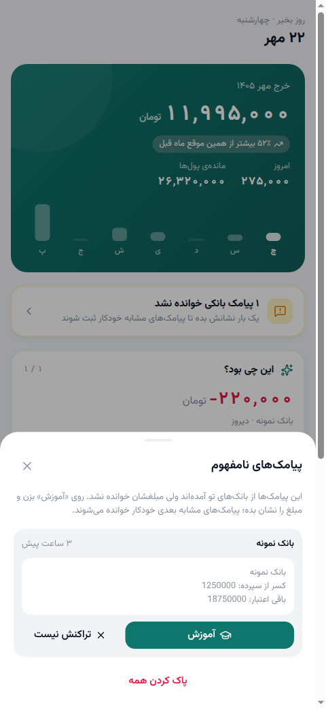

- **آموزش:** تعیین مبلغ، نوع و واحد برای متن مشکل‌دار.
- **تراکنش نیست:** کنارگذاشتن همان پیامک بدون ثبت تراکنش.
- **پاک کردن همه:** حذف همهٔ پیامک‌های نامفهوم پس از تأیید؛ تراکنش‌های ثبت‌شده حذف نمی‌شوند.

بهتر است مرتب به این فهرست رسیدگی کنید؛ حداکثر ۱۰۰ پیامک نامفهوم اخیر نگهداری می‌شود.

### آموزش خواندن پیامک، قدم‌به‌قدم

می‌توانید از سه مسیر شروع کنید:

- خانه → پیامک‌های نامفهوم → **آموزش**؛
- تنظیمات → بانک‌ها → **آموزش پیامک** و قراردادن یک متن نمونه؛
- جزئیات یک تراکنش پیامکی → **مبلغ یا نوع اشتباه خوانده شده؟ آموزش بده**.

۱. اگر از تنظیمات شروع کرده‌اید، متن یک پیامک همان بانک را در کادر وارد کنید.
۲. در پیش‌نمایش روی **عدد مبلغ تراکنش** بزنید، نه مانده، تاریخ، شمارهٔ کارت یا شمارهٔ حساب. پیشنهاد اولیهٔ برنامه را حتماً بررسی کنید.
۳. **هزینه / درآمد** را مطابق واقعیت انتخاب کنید.
۴. **ریال / تومان** را مطابق واحد عدد داخل متن انتخاب کنید.
۵. مبلغ تومانیِ پیش‌نمایش نتیجه را کنترل کنید؛ اگر متن ۱٬۲۵۰٬۰۰۰ ریال است، نتیجه باید **۱۲۵٬۰۰۰ تومان** باشد.
۶. **ذخیرهٔ الگو** را بزنید.

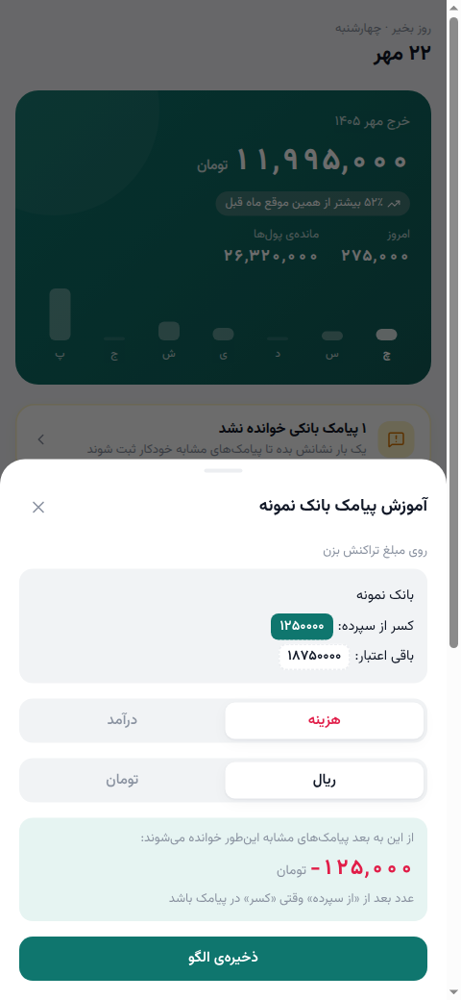

نتیجه به مسیر شروع بستگی دارد:

- **از پیامک نامفهوم:** همان پیامک به تراکنش تبدیل می‌شود و پیامک‌های نامفهوم مشابه همان بانک دوباره بررسی می‌شوند.
- **از تراکنش اشتباه:** مبلغ و نوع **همان تراکنش** اصلاح می‌شود؛ همهٔ تراکنش‌های قدیمیِ ثبت‌شده به‌طور دسته‌جمعی اصلاح نمی‌شوند.
- **از تنظیمات با متن چسبانده‌شده:** الگو ذخیره و پیامک‌های نامفهوم موجود دوباره بررسی می‌شوند؛ چسباندن متن به‌تنهایی آن نمونه را به تراکنش جدید تبدیل نمی‌کند.

الگو، واژه‌های اطراف عدد و نشانهٔ نوع تراکنش را یاد می‌گیرد. اگر کنار عدد متن قابل‌تشخیصی نباشد، دکمهٔ ذخیره غیرفعال و هشدار نشان داده می‌شود؛ نمونهٔ مناسب‌تر یا عدد صحیح را انتخاب کنید. اگر قالب واریز و برداشت متفاوت است، برای هرکدام نمونهٔ جدا آموزش دهید. الگوهای ذخیره‌شده پایین پنجرهٔ آموزش دیده می‌شوند و با دکمهٔ سطل زبالهٔ همان ردیف حذف می‌شوند.

> تغییرهای پنجرهٔ آموزش با **ذخیرهٔ الگو** همان‌جا اعمال می‌شوند؛ ذخیرهٔ جزئیات تراکنش برای تگ، یادداشت و پول جداست. بعد از اصلاح نوع، تگ مناسب هزینه/درآمد و منبع پرداخت را نیز بازبینی کنید.

## ۱۱. یادآور روزانه و ویجت اندروید

### یادآور روزانه

در **تنظیمات → یادآور روزانه** کلید را روشن و ساعت و دقیقه را انتخاب کنید. پیش‌فرض **۲۲:۰۰** است. دقیقه‌ها معمولاً از گزینه‌های **۰۰، ۱۵، ۳۰ و ۴۵** انتخاب می‌شوند. تغییر ساعت فوری ذخیره می‌شود؛ با خاموش‌کردن کلید، یادآور متوقف می‌شود.

اعلان اندروید فقط وقتی موردی منتظر تگ یا پردازش پیامک باشد نمایش داده می‌شود؛ با لمس آن برنامه را باز و تراکنش‌ها را بررسی کنید. برای دریافتش، مجوز اعلان لازم است. زمان اجرا ممکن است به‌دلیل محدودیت‌های سیستم یا باتری چند دقیقه تأخیر داشته باشد. کنترل یادآور در رابط وب هم دیده می‌شود، ولی وب اعلان روزانهٔ بومی اندروید را اجرا نمی‌کند.

### افزودن ویجت صفحهٔ اصلی

۱. در صفحهٔ اصلی گوشی روی فضای خالی نگه دارید.
۲. **ویجت‌ها / Widgets** را باز کنید؛ روش دقیق به لانچر گوشی بستگی دارد.
۳. ویجت PersonalCost را پیدا و به صفحهٔ اصلی اضافه کنید.
۴. با لمس ویجت، برنامه باز می‌شود.

ویجت **خرج ماه، خرج امروز، ماندهٔ پول‌های ماه** (اگر وجود داشته باشند) و **تعداد موارد منتظر تگ** را نشان می‌دهد. جمع‌های مالی از آخرین پردازش برنامه می‌آیند؛ پیامکِ در صف می‌تواند تعداد منتظرها را بالا ببرد، اما برای تبدیل‌شدنش به مبلغ خرج و تازه‌شدن جمع‌ها، برنامه را باز کنید. ویجت وب وجود ندارد.

## ۱۲. پشتیبان‌گیری و انتقال داده

در پایین **تنظیمات → پشتیبان‌گیری** دو دکمه دارید؛ در [تصویر تنظیمات](docs/screenshots/02-settings.png) دیده می‌شوند.

### گرفتن خروجی

۱. **خروجی** را بزنید.
۲. فایل JSON با نامی مانند `personalcost-2026-10-14.json` ذخیره/دانلود می‌شود؛ محل آن به مرورگر یا مدیریت دانلود دستگاه بستگی دارد.
۳. مطمئن شوید فایل واقعاً ذخیره شده و یک نسخهٔ امن بیرون از داده‌های خود برنامه نگه دارید، مخصوصاً قبل از حذف برنامه یا عوض‌کردن گوشی.

فایل شامل **تراکنش‌ها، بانک‌ها و الگوهای آموزش آن‌ها، تگ‌ها و تنظیمات یادآور** است. **فهرست پیامک‌های نامفهوم و صف پیامک بومی اندروید در خروجی نیستند**؛ پیش از انتقال به آن‌ها رسیدگی کنید. مجوزهای اندروید و جای ویجت نیز منتقل نمی‌شوند.

> خروجی رمزگذاری‌شده نیست و ممکن است متن اصلی پیامک، اطلاعات حساب داخل آن، یادداشت‌ها و نمونه‌های آموزش را داشته باشد. آن را عمومی منتشر نکنید و فقط در محل امن نگه دارید.

### بازیابی یا انتقال به گوشی / وب

۱. روی دستگاه فعلی **خروجی** بگیرید و فایل را به مقصد منتقل کنید.
۲. اگر مقصد دادهٔ مهم دارد، **از مقصد هم ابتدا خروجی بگیرید**.
۳. در مقصد به **تنظیمات → پشتیبان‌گیری → بازیابی** بروید و فایل JSON برنامه را انتخاب کنید.
۴. پیام تأیید و تعداد تراکنش‌ها را بخوانید و فقط در صورت اطمینان تأیید کنید.
۵. پس از بازیابی، خانه، تاریخچه، بانک‌ها و تگ‌ها را بررسی کنید. در گوشی جدید دسترسی‌های پیامک/اعلان/باتری و ویجت را دوباره تنظیم کنید.

**بازیابی، تراکنش‌ها، بانک‌ها، تگ‌ها و تنظیمات فعلی را با محتوای فایل جایگزین می‌کند؛ آن‌ها را ادغام نمی‌کند.** ابزار ادغام دو خروجی در رابط وجود ندارد. APK و وب نیز خودکار همگام نیستند؛ برای انتقال از خروجی/بازیابی استفاده کنید.

حذف برنامه یا پاک‌کردن دادهٔ آن، پاک‌کردن دادهٔ سایت مرورگر، و از دست‌رفتن گوشی می‌تواند اطلاعات محلی را از بین ببرد. بازکردن برنامه در مرورگر یا دستگاه دیگر هم به معنی دسترسی به دادهٔ قبلی نیست. از حالت ناشناس مرورگر برای نگهداری بلندمدت استفاده نکنید. به‌روزرسانی APK هم‌امضا معمولاً داده را نگه می‌دارد، ولی پیش از آن پشتیبان بگیرید و برای نصب نسخهٔ جدید، نسخهٔ قبلی را بی‌دلیل حذف نکنید.

## ۱۳. تمرین با دادهٔ نمونه

تصاویر این راهنما بر اساس سناریوی زیر در **مهر ۱۴۰۵** ساخته شده‌اند؛ چند تراکنش شهریور هم برای تاریخچه و مقایسهٔ ماه قبل وجود دارند. این داده‌ها همراه نصب وارد برنامه نمی‌شوند. برای تمرین، می‌توانید موارد زیر را در یک محیط آزمایشی دستی ثبت کنید؛ برای استفادهٔ واقعی فقط دادهٔ خودتان را وارد کنید.

| نوع | مبلغ (تومان) | تگ | از کدام پول؟ |
| --- | ---: | --- | --- |
| درآمد | ۳۰٬۰۰۰٬۰۰۰ | حقوق | — |
| درآمد | ۸٬۰۰۰٬۰۰۰ | پروژه | — |
| هزینه | ۷٬۵۰۰٬۰۰۰ | اجاره | حقوق |
| هزینه | ۱٬۲۵۰٬۰۰۰ | خوراک | حقوق |
| هزینه | ۱۸۰٬۰۰۰ | اسنپ | حقوق |
| هزینه | ۳۰۰٬۰۰۰ | شارژ | حقوق |
| هزینه | ۴۵۰٬۰۰۰ | تفریح | پروژه |
| هزینه | ۲٬۰۰۰٬۰۰۰ | تجهیزات | پروژه |
| هزینهٔ منتظر بررسی | ۲۲۰٬۰۰۰ | بدون تگ | بدون پول |
| هزینهٔ نقدی | ۹۵٬۰۰۰ | خوراک | بدون پول |

نتیجهٔ این سناریو، پیش از ذخیرهٔ فرم‌های نمایشی و رسیدگی به پیامک نامفهوم:

- **درآمد ماه:** ۳۸٬۰۰۰٬۰۰۰ تومان.
- **خرج ماه:** ۱۱٬۹۹۵٬۰۰۰ تومان.
- **خالص آمار کلی:** ۲۶٬۰۰۵٬۰۰۰ تومان.
- **حقوق:** ۳۰٬۰۰۰٬۰۰۰ ورودی − ۹٬۲۳۰٬۰۰۰ خرج = **۲۰٬۷۷۰٬۰۰۰ مانده**.
- **پروژه:** ۸٬۰۰۰٬۰۰۰ ورودی − ۲٬۴۵۰٬۰۰۰ خرج = **۵٬۵۵۰٬۰۰۰ مانده**.
- **ماندهٔ پول‌ها:** ۲۶٬۳۲۰٬۰۰۰ تومان.
- **بدون پول:** ۲۲۰٬۰۰۰ + ۹۵٬۰۰۰ = **۳۱۵٬۰۰۰ تومان**.

خالص کلی با ماندهٔ پول‌ها برابر نیست، چون دو هزینه هنوز به پولی وصل نشده‌اند. برای تمرین، هزینهٔ ۲۲۰٬۰۰۰ تومانی را به «خوراک، از حقوق» وصل کنید: خرج کل تغییر نمی‌کند، اما ماندهٔ حقوق ۲۲۰٬۰۰۰ تومان کمتر و بدون پول فقط ۹۵٬۰۰۰ تومان می‌شود.

## ۱۴. مشکلات رایج و پاسخ پرسش‌ها

| مشکل یا پرسش | چه کار کنم؟ |
| --- | --- |
| پیامک بانک ثبت نمی‌شود | دریافت خودکار فقط APK اندروید است. سرشمارهٔ واقعی، بانک تعریف‌شده و دسترسی‌ها را بررسی و برنامه را باز کنید. در محدودیت‌های باتری/اجرای پس‌زمینهٔ گوشی هم برنامه را بررسی کنید. |
| بعد از افزودن بانک، پیامک‌های قدیمی نیامدند | ورود خودکار تاریخچهٔ صندوق پیامک وجود ندارد؛ تراکنش‌های قدیمی را دستی ثبت کنید. چسباندن متن در آموزش بانک فقط الگو را آموزش می‌دهد. |
| پیامک تازه خوانده نشده است | کارت پیامک‌های نامفهوم خانه را باز و از همان مورد آموزش بدهید. اگر اصلاً آنجا نیست، ابتدا سرشماره و دسترسی‌ها را بررسی کنید. |
| عدد ده برابر یا یک‌دهم واقعیت است | تومان/ریال را کنترل کنید؛ ثبت دستی تومانی است، ولی در آموزش واحد متن پیامک را انتخاب می‌کنید. |
| مبلغ درست است ولی هزینه/درآمد اشتباه است | جزئیات تراکنش را باز، نوع و تگ مناسب را اصلاح و ذخیره کنید؛ برای پیامک‌های مشابه می‌توانید الگو آموزش دهید. |
| «از» یا کارت پول دیده نمی‌شود | ساخت تگ پول کافی نیست؛ درآمد تگ‌خوردهٔ ماه مرتبط ثبت کنید. در «از» فقط ماه تراکنش و تا دو ماه اطراف آن قابل‌انتخاب‌اند. |
| هزینه تگ دارد ولی از حقوق کم نشده | تگ هزینه با منبع پرداخت فرق دارد؛ در جزئیات، «از → حقوق» و ماه درست آن را انتخاب و ذخیره کنید. |
| ماندهٔ پول منفی است | خرج منتسب به آن بیشتر از ورودی ثبت‌شده است؛ درآمدهای جاافتاده و ماه منبع انتخاب‌شده را بررسی کنید. در بازهٔ دلخواه ممکن است درآمد بیرون از بازه باشد. |
| آمار صفر است یا ردیف‌ها کم شده‌اند | ماه/بازه و جست‌وجو را بررسی کنید و «پاک کردن فیلترها» را بزنید؛ فیلترها جمع‌ها را هم تغییر می‌دهند. |
| هم دستی ثبت کرده‌ام هم پیامک آن آمده | پیش از ثبت دستی، تاریخچه را بررسی کنید. جلوگیری از تکرار برای پیامک مشابه است؛ ثبت دستی و پیامکیِ یک خرید خودکار یکی نمی‌شوند. مورد تکراری را با دقت حذف کنید. |
| یادآور نیامد | اندروید، روشن‌بودن یادآور، زمان آن، مجوز اعلان و وجود موارد منتظر را بررسی کنید؛ محدودیت باتری می‌تواند تأخیر ایجاد کند. در وب اعلان بومی ندارید. |
| ویجت مبلغ قدیمی نشان می‌دهد | برنامه را باز کنید تا پیامک‌های صف پردازش و جمع‌ها تازه شوند. |
| داده در وب و گوشی فرق دارد | این دو ذخیرهٔ محلی مستقل دارند؛ با خروجی و بازیابی منتقل کنید، نه با انتظار همگام‌سازی. |
| فایل بازیابی معتبر نیست | فایل JSON خروجی همین برنامه را، نه تصویر یا فایل تغییر‌یافته، انتخاب کنید. قبل از تلاش مجدد از دادهٔ فعلی خروجی بگیرید. |

**روال پیشنهادی:** هر روز تراکنش‌های منتظر تگ و پیامک‌های نامفهوم را بررسی کنید، هر هفته آمار خرج و پول‌ها را ببینید و مرتب خروجی امن بگیرید.
